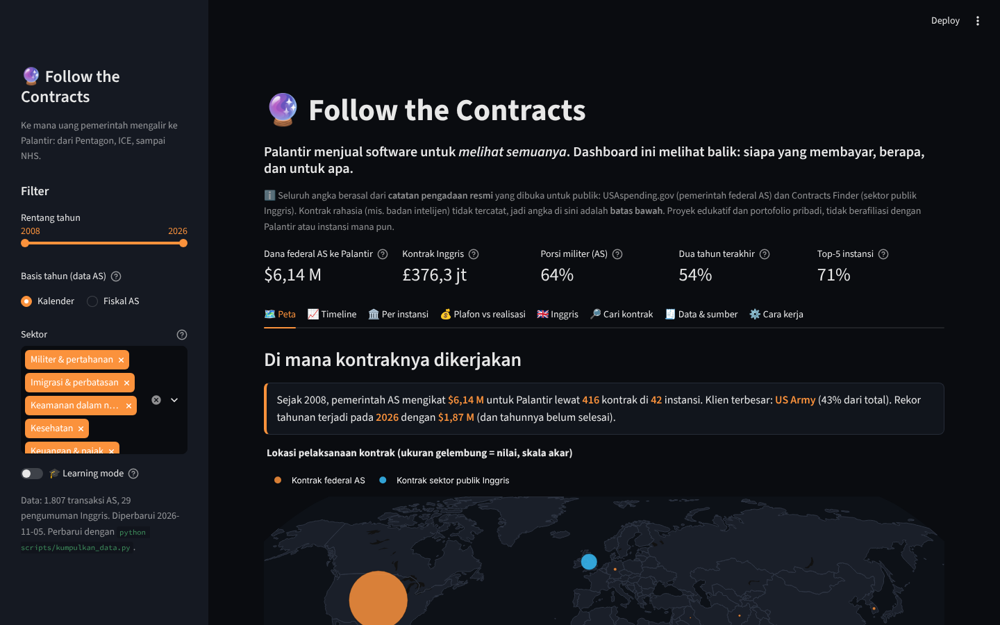
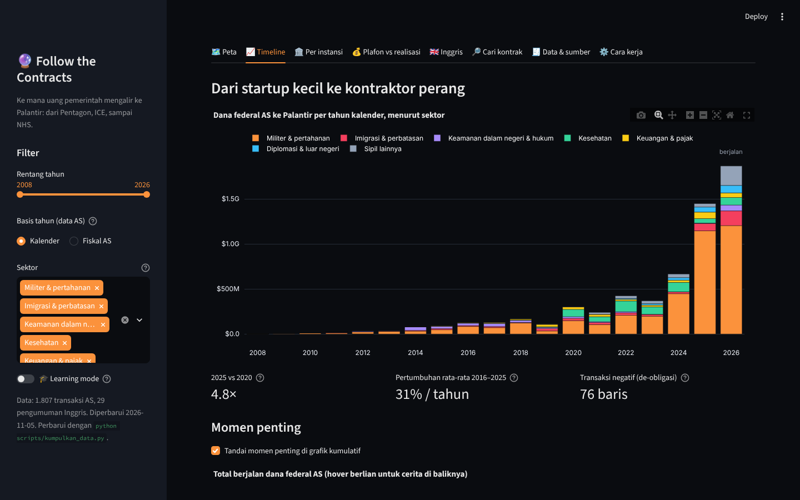
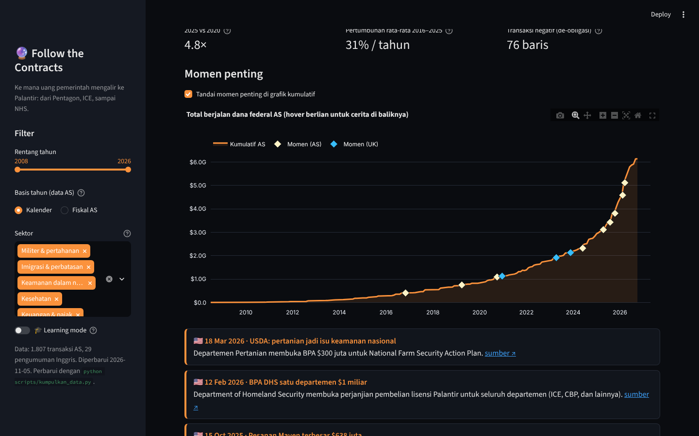
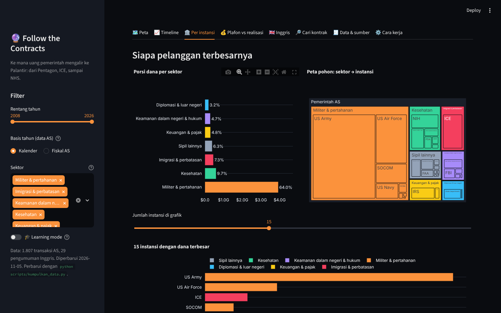
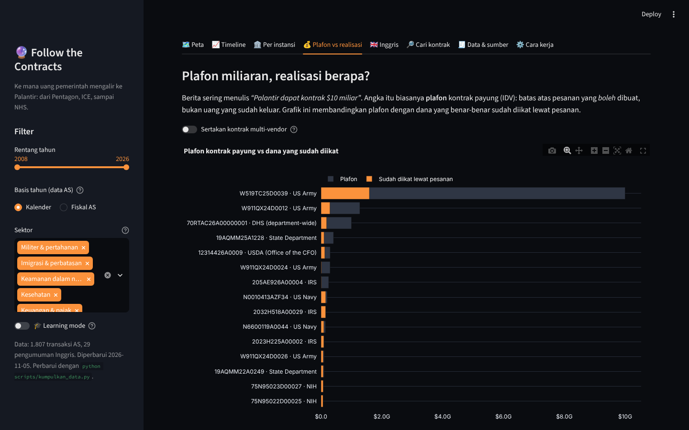
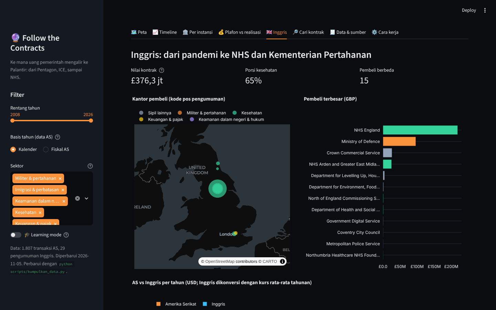
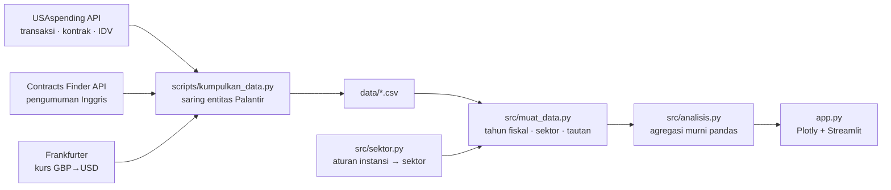

# 🔮 Follow the Contracts

[](https://github.com/Avalon2222/palantir-contracts/actions/workflows/tests.yml) [](https://www.python.org/) [](LICENSE) [](https://palantir-contracts.streamlit.app)

> Peta dan timeline **kontrak pemerintah Palantir** dari catatan pengadaan resmi: **$6,14 miliar** dana federal AS
> (2008–2026, 1.807 transaksi, 42 instansi) dan **£376 juta** kontrak sektor publik Inggris. Dipecah per instansi dan
> sektor (militer, imigrasi, kesehatan, pajak), lengkap dengan perbandingan plafon kontrak vs dana yang benar-benar
> diikat. Python, pandas, Plotly, Streamlit.

## 🇬🇧 In English

**They see everything. Now see who pays.** Palantir sells software built to connect every dot. This dashboard
connects the dots on Palantir itself: every federal contract action in USAspending (2008–2026, $6.14B obligated across
42 agencies) and every UK public-sector award in Contracts Finder (£376M), mapped by agency, sector and year.

- **Trace** $6.14B of US federal obligations by sector: 64% defense, with the Army alone at 43%.
- **Watch** the curve bend: 2025 was 4.8× 2020, and the last two years hold more than half of all money ever obligated.
- **Separate** headline ceilings from real money: the Army's "$10 billion" enterprise agreement is 16% obligated so far.
- **Search** 439 US contracts and 29 UK notices, each linked back to its official record.

**Built with:** Python, pandas, Plotly, Streamlit  
**Data:** USAspending.gov API (US Treasury), UK Contracts Finder API (Cabinet Office), ECB rates via Frankfurter  
**Engineering:** pytest suite with CI on GitHub Actions and a weekly workflow that refreshes all data from the APIs

*The rest of this README is in Indonesian.*

**🚀 Coba langsung di browser:** [palantir-contracts.streamlit.app](https://palantir-contracts.streamlit.app)



> ℹ️ **Disclaimer.** Seluruh angka berasal dari **catatan pengadaan resmi** yang dibuka untuk publik. Kontrak rahasia
> (badan intelijen dan sebagian operasi khusus) tidak tercatat, jadi semua angka di sini adalah **batas bawah**.
> Proyek edukatif dan portofolio pribadi, tidak berafiliasi dengan Palantir atau instansi mana pun.

## Latar belakang

Palantir dikenal sebagai perusahaan yang membuat software untuk "melihat semuanya": menyatukan data intelijen,
logistik perang, catatan imigrasi, sampai data pasien rumah sakit. Namanya sering muncul di berita dengan angka besar
seperti *"kontrak $10 miliar dari Army"* atau *"£330 juta dari NHS"*. Pertanyaannya: **berapa sebenarnya uang
pemerintah yang mengalir ke Palantir, dari instansi mana, dan sejak kapan?**

Jawabannya ternyata tersedia untuk publik. Pemerintah federal AS wajib mencatat setiap aksi kontrak di
[USAspending.gov](https://www.usaspending.gov/), dan sektor publik Inggris mengumumkan kontraknya di
[Contracts Finder](https://www.contractsfinder.service.gov.uk/). Proyek ini mengumpulkan semua catatan itu lewat API,
membersihkannya, lalu menyajikannya sebagai peta, timeline, dan tabel yang bisa ditelusuri. Ironinya disengaja:
software pengawasan diawasi balik dengan data terbuka.

## Temuan utama

| | |
|---|---|
| 💵 **$6,14 miliar** | Total obligasi federal AS ke Palantir Technologies, Palantir USG, dan Palantir USA (Jul 2008 – Okt 2026) |
| 🪖 **64% militer** | Department of Defense mendominasi. US Army sendiri 43%, disusul Air Force (12%) dan ICE (7%) |
| 🚀 **Ledakan 2025–2026** | $1,45 miliar pada 2025 dan $1,87 miliar pada 2026 (tahun belum selesai). Dua tahun ini = 54% dari seluruh dana sejak 2008 |
| 🛂 **ICE $450 juta** | Imigrasi & bea cukai AS; lebih dari separuhnya ($245 juta) jatuh sejak 2025 |
| 🧾 **Plafon ≠ uang** | Army Enterprise Agreement berplafon $10 miliar, yang sudah diikat baru $1,59 miliar (16%) |
| 🇬🇧 **£376 juta di Inggris** | 65% dari sektor kesehatan (NHS, termasuk Federated Data Platform £182 juta) dan 25% dari Kementerian Pertahanan |
| 📍 **63% "dikerjakan" di California** | Place of performance sering kali kantor Palantir sendiri, bukan lokasi instansi pembeli |

## Fitur

| Tab | Isi |
|---|---|
| 🗺️ Peta | Gelembung dunia per negara pelaksanaan (termasuk kontrak Army di Afganistan, Irak, Jerman, Korea Selatan) dan choropleth negara bagian AS |
| 📈 Timeline | Dana per tahun menurut sektor (tahun kalender atau tahun fiskal AS), pertumbuhan 2025 vs 2020, CAGR, dan grafik kumulatif dengan **12 momen penting** yang masing-masing punya tautan sumber |
| 🏛️ Per instansi | Porsi sektor, treemap sektor → instansi, ranking instansi, dan heatmap "kapan setiap instansi mulai membeli" |
| 💰 Plafon vs realisasi | Kontrak payung (IDV/BPA): plafon yang sering jadi judul berita vs dana yang sudah diikat lewat pesanan. Kontrak multi-vendor disembunyikan secara bawaan agar tidak menyesatkan |
| 🇬🇧 Inggris | Peta kantor pembeli, pembeli terbesar, perbandingan AS vs Inggris dalam USD, dan tabel pengumuman |
| 🔎 Cari kontrak | Pencarian teks di semua kontrak (mis. *Maven*, *Vantage*, *COVID*) dengan tautan ke catatan resmi dan unduhan CSV |
| 🧾 Data & sumber | Daftar file, sumber, lisensi, dan batasan data |
| ⚙️ Cara kerja | Alur data dan tabel aturan pemetaan sektor |
| 🎓 Learning mode | Toggle di sidebar: setiap tab menampilkan penjelasan istilah, rumus, dan potongan kode |







## Cara menjalankan

```bash
git clone https://github.com/Avalon2222/palantir-contracts.git
cd palantir-contracts
python -m venv .venv && source .venv/bin/activate   # Windows: .venv\Scripts\activate
pip install -r requirements.txt
streamlit run app.py
```

Buka `http://localhost:8501`. Jalankan pengujian dengan `python -m pytest tests/ -v` (26 tes, tanpa internet).

Memperbarui data (sekitar 1 menit, tanpa API key):

```bash
python scripts/kumpulkan_data.py
```

Workflow GitHub Actions `perbarui-data.yml` menjalankan skrip ini setiap Senin, menguji hasilnya, dan melakukan
commit bila ada kontrak baru.

## Cara kerja (ringkas)



Beberapa keputusan penting:

1. **Daftar putih nama penerima.** Pencarian teks "Palantir" di USAspending juga menemukan *Palantir.net Inc*,
   *PalantirIII LLC*, dan *Lonely Mountain Palantir Enterprises*. Hanya `PALANTIR TECHNOLOGIES`, `PALANTIR USG`, dan
   `PALANTIR USA` yang dihitung.
2. **Obligasi, bukan plafon.** Angka utama adalah `Transaction Amount` (dana yang diikat secara hukum). Plafon kontrak
   payung ditampilkan terpisah di tab *Plafon vs realisasi*.
3. **Multi-vendor dipisahkan.** Kontrak seperti MDA SHIELD (plafon $151 miliar) dibagi dengan ratusan perusahaan,
   sehingga tidak dihitung sebagai milik Palantir.
4. **Inggris disaring dua kali.** Kontrak yang hanya menyebut Palantir (mis. migrasi keluar dari Palantir) dibuang,
   dan framework multi-pemasok tidak dijumlahkan.
5. **Sektor dengan aturan yang bisa dibaca.** `src/sektor.py` memetakan instansi ke 7 sektor dengan regex berurutan,
   bukan model ML, supaya mudah diperiksa dan diuji.

## Struktur folder

```
palantir-contracts/
├── app.py                     # tampilan Streamlit (8 tab)
├── src/
│   ├── sektor.py              # instansi → sektor, nama pendek, warna
│   ├── muat_data.py           # baca CSV + kolom turunan
│   └── analisis.py            # agregasi dan angka ringkasan
├── scripts/
│   ├── kumpulkan_data.py      # ambil data dari API
│   └── tangkap_layar.py       # screenshot README (Playwright)
├── data/                      # snapshot CSV + SUMBER_DATA.md
├── tests/                     # pytest
└── docs/
    ├── BELAJAR.md             # panduan belajar langkah demi langkah
    ├── LATIHAN.md             # latihan bertingkat
    └── screenshots/
```

## Data & sumber

Rincian setiap kolom ada di [data/SUMBER_DATA.md](data/SUMBER_DATA.md).

- **USAspending.gov API** (U.S. Department of the Treasury). Domain publik.
- **Contracts Finder API** (UK Cabinet Office). Open Government Licence v3.0.
- **Frankfurter** (kurs referensi European Central Bank).
- Momen penting dikurasi manual dari pemberitaan dan catatan resmi; setiap baris punya tautan sumber.

## Batasan

- Kontrak rahasia dan penjualan lewat reseller tidak tercatat atas nama Palantir.
- Nilai Inggris adalah nilai kontrak saat diumumkan (sering multi-tahun), bukan pembayaran per tahun seperti data AS.
- Contracts Finder hanya mencakup Inggris (bukan Skotlandia/Wales) dan kontrak di atas ambang pelaporan sejak 2015.
- Tahun terakhir pada data selalu tahun berjalan.

## Rencana berikutnya

- Tambah sumber Uni Eropa (TED) dan negara lain yang memakai Palantir.
- Bandingkan dengan pendapatan pemerintah di laporan tahunan Palantir (10-K) untuk mengukur porsi yang tidak terlihat.
- Analisis teks deskripsi kontrak untuk mengelompokkan produk (Gotham, Foundry, AIP, Maven).

## Lisensi

MIT. Lihat [LICENSE](LICENSE).
